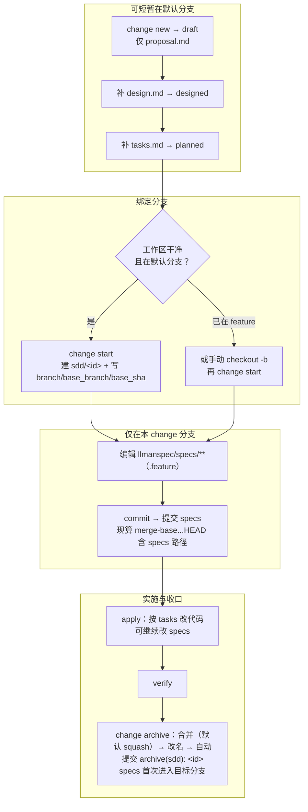

# LLMAN SDD Verify

独立核验实现是否忠实满足该 change 的规格合约、人类定理与项目门禁。

> 位于验证阶段：对象必须已提交 specs 且 `readyToImplement=true`（完成信号）。通过 → `llman-sdd-archive`；失败 → 回 `llman-sdd-apply`。

## 硬约束

- **亲自复跑门禁**：必须亲自重跑 `llman-sdd validate <id> --check --strict`（真实 harness 证据）与项目门禁，不得采信实现者报告；结果不符判 CRITICAL。
- **harness 证据必须显式 `--check`**：缺省 `validate` 跳过 harness，缺省结构门的通过不是通过；收口会执行 `specs.check_command`，收口前不必重复跑。
- **只审查不归档**：CRITICAL 归档前必须清零；不得在此直接跑 `change archive`，也不得中途问“是否继续”。

## 阶段守卫（`stage` / `readyToImplement`）

阶段必须以权威 JSON 判定，不得凭工件表面推断：

```bash
llman-sdd show <id> --output json --type change
```

读字段：`stage`、`specsLanded`、`needsSpecsChange`、`readyToImplement`、`gateChecks`（逐项 `pass` + 未过时的 `hint`）。

| 状态 | 动作 |
|------|------|
| `stage=draft`（仅 proposal.md） | STOP。补 design.md → designed，补 tasks.md → planned，再绑定分支、在绑定分支提交 specs。draft 不能 apply/verify。若已有 proposal+tasks 而仍是 `draft`（缺 design.md——它是 stage 门槛）：先补 design.md。不得建 `changes/<id>/specs/`，不得在默认分支改 specs。 |
| `stage=designed`（proposal + design） | 补 tasks.md → `planned`；规划文档齐全后再 `change start`（绑定分支）。 |
| `stage=planned`（proposal + design + tasks） | STOP 直到绑定：`change start` → `full`。 |
| `stage=full` 且 `readyToImplement=false` | 读未过的 `gateChecks` 分项。specs-landed 门未过 → 在**绑定分支**提交 specs（编辑 `llmanspec/specs/**` 并 commit），或设 `needs_specs_change: false`；不得重跑 `change start`（绑定分支上的 specs 丢失 → checkout/重建 + 绑定分支偏离时 `change start --force`）。specs-landed 门已绿而 tasks-done/validate/clean-tree 未过 → 实施中期的正常状态：继续 apply 勾 tasks，不得当作 specs 未提交。 |
| `readyToImplement=true` | 完成信号：gateChecks 全绿（tasks 全勾 + validate 通过）——verify/finalize 前置已满足。`changes/<id>/specs/` 预期**不存在**，不得当作缺失。 |

## 双轴独立审查

对比现算 `git diff <merge-base>...HEAD`（`merge-base` 现算，不得用审计用 `base_sha` 截断范围），两轴结论分离呈现、互不掩盖：

1. **合约与定理轴**：对照分支上 `llmanspec/specs/**`、`llmanspec/theorems/` 与 `proposal.md`/`design.md`/`tasks.md`，核对需求语义、边界条件、是否违背只读人类定理（如存在则跑 `llman-sdd theorem check`）。前后对比类证据必须核对在 change 分支上测量。
2. **工程标准轴**：对照 `llmanspec/AGENTS.md` 与架构边界检查重复逻辑、职责错位、泄漏抽象与测试缺失（工具已强制项不重复报）。
3. **只读核验与人审关卡**：可跑 `llman-sdd change diff <id>` 复核变更面；无 CRITICAL 后跑 `llman-sdd review`，退出码为 0 时输出分级报告（CRITICAL / WARNING / SUGGESTION）并宜接 `llman-sdd-archive`。


## Git 分支生命周期

两层别混：**分支生命周期**（绑定分支 → 提交 specs → `readyToImplement`）与 **skill 导航**（explore→propose→apply→verify→archive）。提交 specs **不是**独立 skill。

### 速览

1. **先**绑定分支（`change start`）→ `stage=full`；**再**在绑定的非默认分支编辑 `llmanspec/specs/**` 并 commit（提交 specs）。
2. 无合约编辑的 change 设 frontmatter `needs_specs_change: false`。`stage=full` 且 specs-landed 门通过（`specsLanded ∨ needs_specs_change=false`）即可进 apply；`readyToImplement=true`（gateChecks 全过，含 tasks-done）是 verify/finalize 前的完成信号。diff 范围一律现算 merge-base；存储的 `base_sha` 仅审计。
3. 收口一律 `llman-sdd change archive <id>`：先提交使工作区干净，再自动提交 `archive(sdd): <id>`（改名与合并一笔）；`--no-commit` 跳过自动提交。实施期间在 change 分支上分段提交。
4. **不得**为过干净树门禁把 specs commit 到默认分支；已绑定且未给 `--force` 不得重复 `start`。
5. worktree（可选）：`change start --worktree` 在独立 worktree 建分支、不动当前检出（`--base <branch>` 仅本地分支）记录分叉源；在非默认分支上 `change start` 按运行时信号推导分叉源、偏离默认分支时输出 WARNING；`change archive` 目标即绑定分支时跳过合并就地收口，目标被其他 worktree 持有时自动在该 worktree 内执行（输出标注位置）。

### 权威全图



上图为权威全图，本单元即其唯一来源（无需另寻根 `AGENTS.md`）。

Worktree 决策表：

| 工作形态 | 命令 | 判据 |
|---|---|---|
| 单检出 | `llman-sdd change start <id>` | 在默认分支且树干净；直接切到新分支 |
| 保留当前检出 / 并行 change | `llman-sdd change start <id> --worktree` | 分支建于独立 worktree（`sdd.worktree_root` / `sdd.worktree_naming` 可调，缺省仓库根兄弟目录），当前检出不动，输出含 worktree 路径；配 `--base <branch>`（仅本地分支）记录非默认分叉源 |
| 已在 feature 分支（含手工 wt/git-worktree） | `llman-sdd change start <id>` | 分支已存在；分叉源按 `--base` > `branch.<name>.base` / 本地 upstream 推导 > 默认分支，偏离默认分支时输出 WARNING；`--base` 仅接受本地分支 |

`change archive` 目标定位：目标即绑定分支时跳过合并就地收口（输出含 in-place close-out 提示）；目标分支被其他 worktree 持有时，`llman-sdd change archive <id>` 自动在该 worktree 内完成合并、改名与提交（输出含 `executed in target worktree <path>`）；持有 worktree 脏时中止报错并列出处置选项（零写入）。
# 人读摘要（强制）

每份报告、交接或门禁输出，必须 在任何机器细节之前先给人读摘要：

- **结论** — 一行（如“门禁全绿”/“发现 2 个 CRITICAL”）。
- **风险** — 最多三条，按影响降序。
- **待决策** — 明确提问，或“无”。

十行以内；细节放折叠线以下。
> 命令细节用 `llman-sdd <cmd> --help` 查看；命令参考以 CLI 为准，skill 不内嵌命令表。
> 文中“规约”= 本项目 `llmanspec/specs/` 下的 `.feature` 文件；用 `llman-sdd list --specs` / `llman-sdd show <capability>` 查全文。

## 版本漂移提示（`[NOTE] ... scaffolded with llman-sdd X; installed CLI is Y`）

见到该 stderr 提示时：向用户**转述**此提示并宜跑 `llman-sdd init --update`（刷新 managed blocks 与 skills 至当前 CLI 版本）；更新完成前**继续按现有 skill 执行**，不因版本差异中断流程。每进程至多提示一次，属参考信息而非错误。

校验修复（单轨 feature-as-spec）：

1）缺 `# purpose:` 头注释：每个 capability `.feature` 必须含非空 `# purpose:`；`功能:` 标题必须等于 discover 分配后的 spec id（`llman-sdd list --specs` 查看 id）。
```
# language: zh-CN
# purpose: 一句话概述

功能: <spec-id>
```

2）原生分层格式（`rule must carry an @req:<req_id> tag on the rule header`）：
- 规范样式只有一种：`@req:<id>` 挂在 `规则:` 块头标签,块内嵌套 `场景:`(假如/当/那么)是可执行示例——默认首选。
- 仅当需求无法程序化表达或暂不转写时才保留无嵌套场景的 `规则:`(裸规则):描述自由文本,不强制情态词;validate 以聚合计数提示,review `pending` 信号计量,specs-compact 负责压降。
- 历史标签 `@executable`/`@rule`/`@human`/`@manual` 不再使用、解析惰性;旧文件不再提供迁移命令,历史标签保持惰性。
- 不在任何 `规则:` 内的顶层 `场景:` 是功能级示例:无规则句柄、不告警、不参与规则统计(Gherkin 原生语义)。

分支护栏：
- 先 `change start` 绑定分支，再在绑定的非默认分支编辑 `.feature` 并 commit（提交 specs）。
- 锁定规则（报告制）：改/删既有 `规则:` 块只出 WARNING，不阻断 validate / finalize / `change diff`；报告按 `@req:<id>` 指明被改规则。控制点：git 分支对比 + `llman-sdd review` / `change diff`。旧锁定确认元数据（frontmatter `rules_touched` / `agent_acked`、`@agent` tag、`--yes` 确认语义）已全部删除，无别名无兼容层。
- `stage=full` 且 specs-landed 门通过（specsLanded ∨ `needs_specs_change: false`）即可进 apply；verify/finalize 须 `readyToImplement=true`（完成信号）。收口优先 `change archive`。

## Context
- 先查状态再动手：change/spec 状态以 `llman-sdd show/list/validate` 输出为准；读 spec 全文前先 `llman-sdd list --specs`，再直读 `.feature`。

## Goal
- 达成一个可验证结果；报告附结果路径与校验状态。

## Constraints
- 遵守正文硬约束与 `llmanspec/theorems/` 只读人类定理（不得由 Agent 擅自修改）。先判断规模选路径：合约变更走完整 SDD，实现层走 quick；不确定选完整 SDD。改动最小；已知校验错误不得强行继续。

## Workflow
- 每步以 `llman-sdd` 命令结果为事实来源；改动工件后必跑 `llman-sdd validate`；命令细节见 `llman-sdd <cmd> --help`。

## Decision Policy
- 高影响歧义先澄清再继续；事实自己查证，只有决策问用户。

## Output Contract
- 先给人读摘要（结论 / 风险 / 待决策），机器细节随后。

## Ethics Governance
- `ethics.risk_level`：low——只读写本仓库与 `llmanspec/`，无外发动作；正文另有声明时按正文执行。
- `ethics.prohibited_actions`：违反正文硬约束的动作；用户未明确要求时，不得 push、发 PR 或向外部上传。
- `ethics.required_evidence`：结论必须给出命令输出或文件路径；门禁状态以 `llman-sdd validate` 输出为准。
- `ethics.refusal_contract`：门禁 CRITICAL 未清零时，不得进入下一阶段；自修复达到上限时，报告 blocker。
- `ethics.escalation_policy`：改动 SDD 合约、模板，或执行不可逆动作前，必须先取得用户确认。
