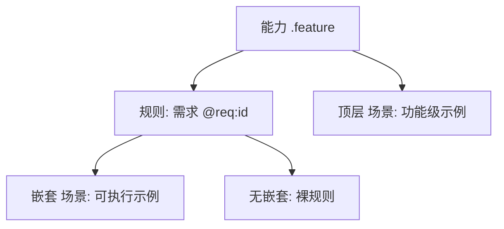
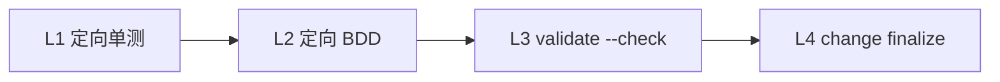
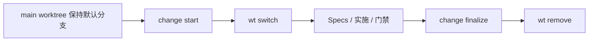

<!-- LLMANSPEC:START -->

# llmanspec AGENTS.md

此文件由根目录的 `AGENTS.md` 托管块引用。可在此添加项目特定的规则、
上下文或约定，以便 AI 代理遵守。

<!-- 在此行下方添加你的规则 -->
<!-- LLMANSPEC:END -->

## 项目定位

llman-sdd:spec 驱动开发工作流(TypeScript + Bun),完全接替 Rust llman 中的 sdd 子系统。本仓库自托管 SDD 流水线并自举——行为合约由本工具自身管理。

| 权威 | 位置 |
| --- | --- |
| 本工具行为合约 | `llmanspec/specs/` |
| 前代契约参考(只读) | `../llman.old-rs-impl-sdd/` |
| 活跃 change | `llman-sdd list` |

## AGENTS.md 文风

编写与更新本文件(及根 `AGENTS.md` 自述段)时遵守下表。目标是让约束可执行、少过期。

| 原则 | 做法 |
| --- | --- |
| 加粗克制 | 只有真的需要高度注意的才加粗 |
| 表格优先 | 并列对比、字段、选型用表 |
| 图优先 | 流程、层次、生命周期用 mermaid |
| 有重心 | 每节只守一类约束;细节下钻到目录或 CLI,不在此展开 |
| 数字即基线 | 不写可复现的过程数字;门禁基线与运行时下限除外 |
| 引目录 | 引目录,不引易漂移的具体文件 |
| 少回归 | 不写会随重构过期的接线细节 |
| 不锁哈希 | 不写锁定哈希、提交 SHA 等难维护锚点 |
| 用词平常 | 不用 emoji 与生僻符号 |
| 只写现在 | 写当前形态;不写已删除、已移除、已移动 |
| 不列脚本 | 脚本首行模块注释即描述;此处只写目录组织规律 |

## 技术栈

后续需求直接引用本表,勿重新调研。

| 层 | 选型 | 约束 |
| --- | --- | --- |
| 运行时 | Bun(`.bun-version`) + Node(`.node-version` / engines) | **运行时代码只准 `node:` / Web 标准 API**;Bun 专属 API 仅允许出现在构建/测试脚本。Node 下限以 engines 为准(`>= 24`) |
| 语言 | TypeScript | 仅 typecheck,不参与构建 |
| 布局 | Bun workspaces | `packages/core` 纯域逻辑;`apps/cli` 命令入口 |
| 分发 | Bun 直跑 TS + `bun build --compile` | CLI 与二进制不经过打包器 |
| Web | 未落地;若引入,打包器为 rsbuild | 以独立 change 引入 |
| 工具链 | oxlint + oxfmt、tsc --noEmit、prek、just | oxfmt 忽略 `llmanspec/` 与 `AGENTS.md`(格式归 llman 管) |
| 测试 | bun:test + `tests/bdd/` Gherkin runner | BDD 选型已终局 |

| 包 | 用途 |
| --- | --- |
| commander | CLI |
| nunjucks | 模板 |
| @cucumber/gherkin | spec 解析(官方 i18n 含 zh-CN「规则」) |
| @toon-format/toon | 机器输出 TOON 编码 |
| zod | 配置契约(v4 内建 toJSONSchema) |
| yaml | 配置读写与注释保留 |
| 7z-wasm | 冻结冷备 |
| ignore | gitignore 语义层叠,freeze 内容过滤 |

## 范围

后续需求直接引用本节,勿重新调研。命令面以 CLI `--help` 为准,勿凭前代记忆补表面。

| 面 | 当前约定 |
| --- | --- |
| 冷备 | `archive freeze/thaw` 为核心能力;`.7z` 须与前代冻结产物双向兼容 |
| 迁移 | `project migrate` 保留入口;手册按版本组织;`prompt` 以版本范围查询聚合输出 |
| worktree | 单 change 单 worktree;`change start --worktree` 与 finalize/archive 感知目标 worktree |
| 交互 | 只在 CLI 适配层;core 不发起终端交互。ink 是 TUI 战略方向;向导库与 ink 禁止同进程混用 |
| JSON 别名 | `--json` / `--compact-json` 的结构与退出码对齐前代 |
| 缺省输出 | 报告型命令缺省 TOON;`--output` 切 `toon` / `json` / `compact-json` / `human`。`human` 是前代人读形态入口;其余人读细节不做逐字节对齐 |
| `规则:` 改动 | git 分支对比 + `review` / `change diff` 审视;不经 validate/finalize 锁定通道 |
| 托管块 | init 写入 LLMANSPEC 标记,保留 |
| 修饰符 | `show --output` 等以 `llmanspec/specs/` 为准 |

原生 Gherkin 是唯一规范样式:

- 需求 = `规则:` 块(`@req:<id>` 挂块头 + 自由文本,无 MUST 词强制)
- 可执行示例 = 块内嵌套 `场景:`(假如/当/那么)
- 裸规则计入聚合与 review pending,交 specs-compact 压降
- 顶层 `场景:` 无句柄、不告警、不参与规则统计
- `spec add-req` 追加 `规则:` 块(req 全局唯一);`spec add-scenario` 向规则块插入嵌套 `场景:`
- 非原生形态用 `spec migrate-native` 转入;既有非标准标签不参与判定

## Change Proposal Frontmatter SSOT

`changes/` 下任意深度含 `proposal.md` 的目录都是 change(叶子目录名 = change id;扫描深度由 `--max-scan-depth` 约束)。frontmatter YAML 是变更元信息的唯一权威;生命周期阶段由 CLI 从磁盘工件 + git 绑定实时推断,绝不写入 frontmatter。正文不得复读 frontmatter 字段;H1 宜为人类可读标题,不复读 change id(freeze 取 title:frontmatter `title` 非空优先,H1 回退)。

| 字段 | 必填 | 谁写入 | 说明 |
| --- | --- | --- | --- |
| `depends_on` | 是(骨架默认 `[]`) | agent | 依赖 change id 列表,流式/块式均可 |
| `title` | 是(骨架默认 `TODO` 占位) | agent | 一句话概念式标题,不得复读 change id;缺失或空串 → validate ERROR;freeze 平铺卡 title 的优先来源 |
| `blocks` | 否 | agent | 反向依赖声明(当前仅校验列表格式) |
| `branch` | 否 | CLI(`change start` / `attach`) | 绑定特性分支 |
| `base_branch` | 否 | CLI | finalize/archive 合并目标;缺键回退本地默认分支。不参与 diff 范围(现算 merge-base) |
| `base_sha` | 否 | CLI(`change start`) | 审计用基点,仅审计不参与范围计算 |
| `needs_specs_change` | 否(缺省 true) | agent | false 跳过 specs landing 检查 |

`base_branch` 解析序:`--base` → `branch.<name>.base` / 本地 upstream → 默认分支(init.defaultBranch → main → master → origin/HEAD → origin/*)。

合法集外字段 → validate ERROR,错误消息列出字段名与合法集。`changes/archive/` 下的 proposal 免检。

## 工程规则

- `packages/core` 保持纯域逻辑:文件系统 / git / 终端副作用一律经接口注入
- nunjucks 调用收敛在 `packages/core/src/templates/`,且无 loader、`autoescape: false`,trim/尾换行语义对齐 minijinja
- 验收基线:行为合约 SSOT 为 `llmanspec/specs/`;skills 生成物与 `tests/golden/` 在相同 config 下归一化 diff 为空
- BDD:带步骤的 `场景:`(含 `规则:` 内嵌套)必须可被 `bun test tests/bdd` 执行
- specs 写法:zh-CN Gherkin 关键字(功能/场景/规则),与 `locale: zh-Hans` 一致
- 门禁 verbosity:`just qa` 默认静默(工具原生安静开关 + 每步一行摘要);`just QA_VERBOSE=2 qa` 全量排障。禁止 grep/sed 过滤管道作门禁主路径;输出噪音先修根因。任何档位失败详情与 exit code 必须完整
- **tasks.md 只列实现与验证任务**:收口(`change finalize` / `change archive`)是流水线步骤,不得列为任务——收口任务会让实施期 `validate --strict` 永红
- 门禁证据:`validate` 缺省只做结构/状态门。全量 harness 证据须经显式 `validate --check` 或 `change finalize` / `archive` 预合并验收。报告声称 harness 合格时必须已用 `--check`;harness 失败不得以「自指/固有属性」定性后绕过。临时仓库子进程须剥离嵌套守卫(`LLMAN_SDD_HARNESS_ACTIVE`)
- 验证按成本逐级扩大,避免无需全量时每轮白跑 finalize 级验收:

- 测试子进程与临时目录:起 CLI 与全新顶层上下文走 `tests/helpers/`。临时目录一律 `mkdtempSync(join(tmpdir(), …))`,禁止硬编码 `/tmp`
- 前后对比类验收的基线必须在 change 分支上相对 merge-base 测量;在默认分支上测得的空差不构成证据
- 改动 `packages/core/templates/` 或 CLI 命令/旗标面的 change,须在绑定分支运行 `init --update` 并提交刷新后的 `.agents/skills/`
- **编辑与验证不得放在同一批并行工具调用中**;验证须在编辑落盘后串行执行

## 仓库组织

脚本与 recipe 的用途写在各自首行注释里,本文件不枚举清单。

| 目录 | 形态 |
| --- | --- |
| `packages/core/` | 纯域逻辑 |
| `apps/cli/` | commander 入口;交互只在此层 |
| `apps/cli/scripts/` | CLI 二进制构建 |
| `tests/` | `unit/` 直接导入、`bdd/` Gherkin runner、`golden/` 快照、`integration/` 产物、`helpers/` 夹具 |
| `scripts/` | 仓库级门禁与生成脚本,常与同目录 json 基线成对 |
| `eval/` | 外部影响面剧本,不进 `just qa` |
| `llmanspec/` | `specs/` 行为合约、`changes/` 提案、本文件为项目规则 |
| `packages/core/templates/` | skill 模板 |
| justfile | 门禁入口 `just qa`;单门 `qa-` 前缀;`check` / `test` 为合约钉名 |

棘轮类基线(只许随 change 下调)落在 `scripts/` 的 json,不把数字抄进本文件。

## 语言约定

- change 文档(proposal/design/tasks)用中文;代码、标识符、CLI 输出文案用英文。例外:长操作阶段进度提示随项目 config locale 提供 zh/en 短提示,走 stderr,实现在 `apps/cli/`
- commit message:conventional type 前缀(英文)+ 中文描述,如 `feat(sdd): 新增校验引擎`

## 并行开发

工具:worktrunk(`wt`)。项目配置在 `.config/`。心智模型:一个 change 分支 = 一个 worktree = 一个独立 agent 工作区。

- 收口一律 `change finalize`,不用 `wt merge`(finalize 负责 specs SSOT 改名与 archive 提交)
- 同批并行 change 的 `llmanspec/specs/` 必须两两不相交;触碰同一代码文件的改动不得并行
- worktree 内 `just qa`;合并顺序由 main worktree 串行执行
- 多 agent 拉起:`wt switch sdd/<id> -x <agent-cli>`;监控 `wt list` / `wt step for-each`
