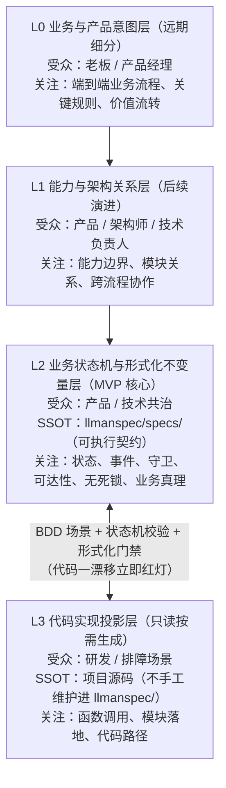
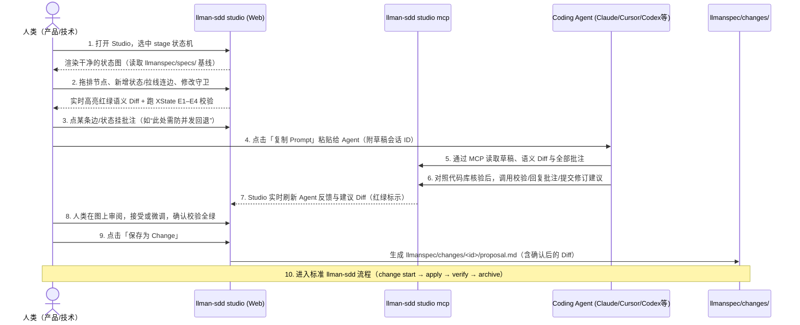

# llman-sdd Studio 产品需求文档（PRD）

> 文档状态：草案 v0.2（已纳入「CLI-first + Skill 主导、MCP 做超薄壳」与 5 态 UI 交互约束，尚未冻结为行为合约）。
> 关联提案：[proposal.md](./proposal.md) ｜ 调研材料：[bidirectional-state-editor.md](./research/bidirectional-state-editor.md) · [mcp-and-verification-landscape.md](./research/mcp-and-verification-landscape.md) · [tech-stack-candidates.md](./research/tech-stack-candidates.md) · [formal-verification-landscape.md](./research/formal-verification-landscape.md) · [cli-subcommand-design.md](./research/cli-subcommand-design.md) · [ux-interaction-design.md](./research/ux-interaction-design.md)

---

## 1. 产品愿景与核心定位

### 1.1 我们要解决什么问题

在 AI 辅助开发（Agentic Coding）流程中，人类与 Agent 的协作存在三个核心断层：

1. **图与代码开局即分道扬镳**：人类用 Excalidraw、Mermaid 或 Project Graph 画出第一版业务流程交给 Agent 实现，之后需求每次迭代都在聊天框里口头改代码，最初的图迅速过期变成废纸。
2. **纯文本规格不利于人类掌控全局逻辑**：`llmanspec/specs/` 里的 Gherkin 与 Markdown 表格对机器和校验非常友好，但当状态分支、守卫条件变复杂时，人类很难靠读表格直观发现逻辑漏洞，更难用直观交互迭代业务流程。
3. **缺乏「人类守真理、Agent 做实现」的控制面**：理想状态下，人类应该把精力放在**业务意图、状态流转、形式化不变量**上，而不是每天去读 Agent 写的每一行具体代码。但如果缺少清晰的可视化控制面与校验闭环，Agent 很容易在实现过程中悄悄弱化或偏离业务真理。

### 1.2 一句话定位

**`llman-sdd studio` 是面向人类的低认知负担可视化规格控制面，以「CLI-first + Skill」为主通道、`llman-sdd studio mcp` 为超薄补充壳，搭建人类与编码 Agent 之间的结构化协商桥梁。**

- 人类在画布上按 **5 态 UI 状态机**（`Explore / Simulate / DraftEdit / ReviewDiff / Negotiate`）查看、试跑、修改、批注状态机，实时看到**红绿语义 Diff**与 **`@statelyai/graph` E1–E4 校验**。
- Agent 优先通过 **结构化 Prompt + `llman-sdd studio` CLI（缺省 TOON、零配置、适配多 worktree）+ Skill** 读写 `.llmanspec-studio/` 本地草稿会话完成核验与修订建议回推；无 Shell 客户端或未来的有状态推送/订阅场景则经 **`llman-sdd studio mcp`** 接入同一份核心逻辑。
- 双方达成一致后，变更统一沉淀为标准的 **`llman-sdd` Change**，进入既有 SDD 流水线，绝不破坏 `llmanspec/specs/` 的 SSOT 纪律。

---

## 2. 分层视角与 SSOT 原则（解决“既要分层细节、又怕文档漂移”）

不同的角色关心不同粒度的细节：老板和产品关心业务形态是否合理，架构师和技术负责人关心状态机与技术边界是否严密，开发与 Agent 关心代码如何落地。

为了同时满足**多层级查看**与**不发生静默漂移**，Studio 采用 **「分层双源 + 可执行契约绑定」** 原则：



| 层级 | 谁最关注 | 真源（SSOT）在哪里 | 为什么不会漂移 |
| --- | --- | --- | --- |
| **L0–L1 业务与架构层** | 老板、产品、架构师 | `llmanspec/`（高层意图，保持极薄，不写代码细节） | 不记录易变的源码实现细节，只约束能力边界与业务意图 |
| **L2 状态机与不变量层（MVP）** | 产品与技术共治 | `llmanspec/specs/` 状态流转契约 | 转移表的每一行由可执行 BDD 测试直接驱动源码；叠加 XState 门禁与未来形式化不变量，漂移即报错 |
| **L3 代码实现层** | 技术排障 / Agent | **项目源码本身** | 不手写维护文档；需要看代码逻辑时按需从源码自动投影生成 |

> **关键底线**：Studio 中的任何画布编辑都是**暂存增量（Staging Diff）**，**绝不直接覆写默认分支的 `llmanspec/specs/`**。只有经人类与 Agent 协商确认、落为 `change` 并走完 `change start → apply → verify → archive` 后，新真理才正式合入 `specs/`。

---

## 3. 核心用户旅程（End-to-End Workflow）

以“演进 `change-lifecycle` 的 `stage` 状态机（增加回退或审核状态）”为例，完整体验如下：



---

## 4. MVP 范围定义（v0.1）

### 4.1 MVP 必须交付的核心能力

| 编号 | 模块 | 用户价值与核心行为 |
| --- | --- | --- |
| **F1** | **状态机导航与聚焦画布** | 左侧按能力（`.feature`）列出所有纳管的状态流转表，每次主画布聚焦**一张**状态机；支持合理自动布局（处理分支、回环、终态）与自由拖拽，节点坐标存入独立 sidecar，不污染语义。 |
| **F2** | **交互式图编辑与红绿语义 Diff** | 画布支持新建/重命名/删除状态、拖端口新建转移边、编辑事件与守卫（`event [guard]`）、删除转移；实时对比 `llmanspec/specs/` 基线，用**绿色（新增）、红色（删除）、黄色（修改目标/事件/守卫）**直观呈现 Diff，纯拖拽不产生 Diff。 |
| **F3** | **图元级锚定评论** | 点击任意**状态节点**、**转移边**或**整张状态机**可添加/解决评论线程；评论绑定稳定语义 ID（如 `cap/req/from:event[guard]->to`），重排节点或重新布局不丢锚点。 |
| **F4** | **实时 XState 形式化校验** | 直接复用 `packages/core` 的解析与 E1–E4 门禁（结构与占位符、确定性、可达性、死锁/陷阱）；画布每次编辑实时重算，出错节点/边在图上高亮并给出清晰修复提示。 |
| **F5** | **双出口：复制 Prompt + 保存为 Change** | ① **复制 Prompt**：类似 ThoughtDAG“所选即上下文”，透明显示待发送上下文胶囊（含锚点、红绿 Diff 摘要、评论、校验诊断与 CLI/MCP 衔接指令），一键复制；② **保存为 Change**：达成一致且校验通过后，一键落盘为合法的 `llmanspec/changes/<id>/proposal.md` 草案（遵守 Frontmatter SSOT）。 |
| **F6** | **CLI-First 协商通道 + 超薄 `studio mcp` 壳** | 优先提供完备的 `llman-sdd studio` 读/写协商子命令（`diff`、`validate`、`prompt`、`comment reply`、`revise`、`sessions`，缺省 TOON，配 Skill），直接读写 `.llmanspec-studio/` 并由网页实时 watch 刷新；同时提供复用同一份 `packages/core` 的超薄 `llman-sdd studio mcp` 壳，服务无 Shell 客户端并为后续推送/订阅等有状态交互留口。 |
| **F7** | **实时 `llman-sdd graph` Change 依赖 DAG 视图** | 将 CLI 面向 Agent 输出的 Mermaid 依赖图（`llman-sdd graph`）实时呈现在 Studio Web 面板中（候选采用 MIT 开源零依赖的 `obsidianmd/pele` 同步渲染并匹配冷静主题），人类可随时直观查看全仓活跃/归档 Change 的编排进度与依赖关系。 |

### 4.2 MVP 明确不做（Non-Goals）

为了避免再次滑入“大而全但不好用”的泥潭，MVP 明确排除以下内容：

- **不直接改写 `llmanspec/specs/`**：严守 SDD 生命周期，草稿确认后一律落到 `change`。
- **不把普通 BDD 规则/场景强行铺成画布方块**：画布保持纯粹的流程图/状态图体验，普通规则正文只在需要时作为侧栏上下文参考。
- **暂不内置自由白板（Excalidraw）或任意 Mermaid 图编辑**：v0.1 仅做状态机适配器，但底层数据结构与画布壳子预留多图适配器接口。
- **暂不接重型外部形式化求解器（TLA+ / Lean）**：v0.1 夯实 XState E1–E4；为后续不变量规则与 TLA+/Quint 导出留出清晰的领域模型边界。
- **暂不内置大模型聊天框**：Studio 不绑定特定模型供应商，而是通过 **Prompt 复制 + MCP** 服务用户自己常用的任意 Agent 工具。

---

## 5. 界面概念草图（Wireframe）

```text
+---------------------------------------------------------------------------------------------------+
| llman-sdd studio   [状态机: change-lifecycle / stage ▾]   [Diff: +1 状态 +2 边 ~1 守卫]  [校验: ✓] |
|                                                        [复制 Prompt]  [保存为 Change]  [重置草稿] |
+---------------------+-----------------------------------------------+-----------------------------+
| 状态机清单           |                 交互式状态图画布               | 检查器 / 评论 / 协商        |
|                     |                                               |                             |
| ▾ change-lifecycle  |     +-------+    add_design    +----------+   | [选中: planned -> full]     |
|   ● stage 迁移表 [2] |     | draft | ---------------> | designed |   | 事件: bind_branch           |
|                     |     +-------+                  +----------+   | 守卫: clean_worktree  (改)  |
| ▾ (未来更多状态机)   |                                     |         |                             |
|   ○ ...             |                                 add_tasks     | --- 锚定评论 (2) ---        |
|                     |                                     v         | [人类] 非默认分支已有分支时 |
|                     |   +----------+  rollback (绿)  +---------+    |        要不要允许直接绑定?  |
|                     |   | rejected | <-------------- | planned |    | [Agent via MCP]             |
|                     |   +----------+                 +---------+    |   代码支持复用现有分支，    |
|                     |                                     |         |   建议加 guard: on_feature  |
|                     |                                bind_branch    |   [采纳修订建议]            |
|                     |                                     v         |                             |
|                     |                                 +------+      | --- XState 校验 (E1-E4) --- |
|                     |                                 | full |      | ✓ E1 结构与占位符           |
|                     |                                 +------+      | ✓ E2 确定性                 |
|                     |                                               | ✗ E3/E4: rejected 无法终结  |
|                     |  图例: [绿]新增 [红]删除 [黄]修改 [💬]有评论   |   → 点击定位到 rejected     |
+---------------------+-----------------------------------------------+-----------------------------+
```

---

## 6. Agent 协商双通道蓝图：CLI-First（主）+ 超薄 MCP 壳（补）

两套入口共享 `packages/core` 纯域逻辑与 `.llmanspec-studio/sessions/` 本地草稿（Studio Web 经 `fs.watch` 秒级刷新），**零重复实现**：

| 协商能力 | CLI 一等命令（主通道，缺省 TOON + Skill） | 超薄 MCP 映射工具（无 Shell / 有状态通道） | 对人类画布的效果 |
| --- | --- | --- | --- |
| 发现草稿与状态机 | `llman-sdd studio sessions list` | `studio_list_sessions` | 无副作用（只读） |
| 拉取语义 Diff 与评论 | `llman-sdd studio diff [session]` | `studio_get_diff` | 无副作用（只读） |
| 校验草稿或假设补丁 | `llman-sdd studio validate [session]` | `studio_validate_draft` | 无副作用（只读） |
| 回复图元锚定评论 | `llman-sdd studio comment reply <session> <id> --body ...` | `studio_reply_comment` | 人类侧栏实时看到 Agent 回复 |
| 提交结构化修订建议 | `llman-sdd studio revise <session>` *(stdin JSON)* | `studio_propose_revision` | 画布叠加虚线红绿建议层，由人类一键采纳或忽略 |
| 未来有状态推送/订阅 | *(不适合短命 CLI)* | `resources/subscribe` / 主动唤醒回调 | 画布点“呼叫 Agent”主动唤醒或同步当前焦点 |

> 注：详细 CLI 契约与对比见 [research/cli-subcommand-design.md](./research/cli-subcommand-design.md)；低认知负担 5 态界面交互见 [research/ux-interaction-design.md](./research/ux-interaction-design.md)。

---

## 7. 演进路线图与长期护栏（一页总览）

> 原则：保留 `llmanspec/specs/`，采用 **Obsidian 式 Tag-first 组织**（绝不强行按僵硬目录切分跨领域业务）；坚持 **低侵入、可混用外部优秀 Skills**，以自动化路由 + 逻辑漂移校准守住 SSOT，而非“一言堂”重仪式。

| 阶段 | 对应 Change / 主题 | 核心交付与演进重点 |
| --- | --- | --- |
| **MVP（已规划 `planned`）** | **C1–C3**：纯域底座 + CLI-first 协商 + Web 工作台 | 亮色多皮肤画布 + 5 态 UI + Git 式变更时间线 + 可扩展 Linter + XState 试跑 + `pele` 实时变更依赖 + Studio 自身状态机自举；CLI + Skill 为主通道，零新 TOON 耦合 |
| **MVP 扩展（已规划 `planned`）** | **C4–C6**：超薄 MCP + 多 Tab 业务森林 + 跨语言 Trace 防漂移 | 自适应多 worktree MCP 壳；按 **Tag-first** 动态聚合多 Tab 业务森林 + 多级下钻 + 交叉桥 + 大图聚焦邻接；0-Token JSONL Trace + `@llmanspec:` 锚点 + `llman-sdd-studio-drift` 逻辑漂移校准 |
| **效率与协作升级（Roadmap）** | **可扩展自动路由 + 非侵入逻辑漂移校准 + Git 兜底协作** | ① 借鉴 `poteto-mode` 建立**可扩展的路由策略集**（不写死模板：支持直接处理、Plan-Exec、旁路漂移校准、经典 SDD 4 步等按变动特征灵活分流）；② 自由混用其他外部 Skills 时，由 Git/Agent Hook 跑 0-Token 漂移检测并触发**逻辑漂移校准**同步 SSOT；③ 归属默认由 **`git blame` / `CODEOWNERS` 零标注兜底**（显式 `@owner:` 仅作可选覆盖），叠加多人异步评论署名与 PR 语义 Diff 审阅，告别一言堂 |
| **高阶表达与精准召回（Roadmap）** | **一等 `*.machine.yaml` + TextFold 真折展 + 混合召回 + 形式化** | ① `llmanspec/specs/` 内可选引入一等 `*.machine.yaml`，配合**结构化清洗 + 内容哈希增量缓存索引**缓解 Tag-first 文本量与召回成本；② 长规则/提案文本接入 **TextFold 5 级语义折展（`全文 › 简述 › 关键句 › 要点 › 主题`）**（按哈希缓存，区别于图字段的程序化显隐）；③ 集成 `inkeep/visimer`（广义 Mermaid 双向编辑）与 `tt-a1i/archify`（专攻**老项目迁移与错位反向同步**）；④ Studio 接入 **RAG + EmbeddingGemma + Decision Model** 路由召回，状态机 IR 向上导出 Alloy → Quint/TLA+/P → Lean/Dafny/Verus |
