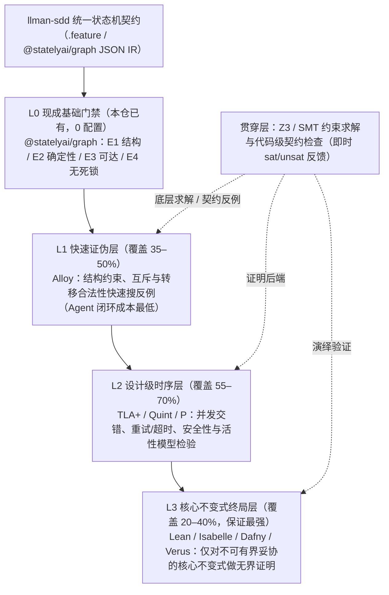

# 形式化验证工具评估与分层组合策略（状态机视角）

> 性质：长期验证架构调研材料（尚未冻结为行为合约）。整理日期：2026-11-25。
> 锚点：对照 Code Verification Atlas 中的「形式化验证」分支（模型检验、定理证明、抽象解释、契约验证），结合业务状态机建模视角与 Agent 协作适应性进行评估。

---

## 1. 核心前提与评估尺度

**没有任何单一工具能同时最大化「覆盖占比」与「验证严格性」。** 越接近代码级证明，覆盖行数越少但结论越硬；越偏向设计级模型，覆盖逻辑面越广但严格性通常是有界的或需要额外精化。

评估“覆盖占比”须先区分两个尺度：

- **尺度 A（逻辑/流程覆盖）**：在“有模式、有时序、有中断”的状态机管辖范围内，工具能覆盖多少比例的**流转决策逻辑**。
- **尺度 B（代码级/系统级覆盖）**：在整个软件制品（含数据变换、I/O、UI 细节、外部集成）中，工具能直接施加严格保证的比例。

下表覆盖占比区间均指**尺度 A（流程决策逻辑）**，并显式区分保证是**有界**还是**无界**。

---

## 2. 候选工具逐项汇总评估

| 工具 | 覆盖占比（尺度 A） | 验证严格性 | Agent 协作适应性 | 核心定位与取舍要点 |
| --- | ---: | --- | ---: | --- |
| **P**（微软状态机编程语言） | **65–80%** | 有界/系统化（模型检验 + 符号执行） | **3 / 5** | 状态机原生，最接近“可形式化验证的 XState”；减少规格到实现翻译损耗，但社区与 LLM 训练语料较 TLA+ 小 |
| **Event-B / B-Method** | **60–75%** | 无界（精化证明义务） | **2.5 / 5** | 纵向精化链条最强（高层状态机 → 底层数据结构），但偏向“正确构造”，建模门槛高、不适合探索式快迭代 |
| **TLA+ / PlusCal** | **55–70%** | TLC 有界 / TLAPS 无界 | **4 / 5** | 并发、异步、重试/超时等交错敏感逻辑的设计级首选；Agent 生态成熟（可生成 TLA+ 或翻译证明义务到 Verus），需人工把关防“语法对但语义空洞” |
| **Alloy** | **35–50%** | 有界严格（受限于 scope） | **4.5 / 5** | 轻量级关系逻辑，极擅长结构约束、不可达状态、互斥规则的快速证伪与反例可视化；极适合 Agent“生成—反例—修正”低成本闭环 |
| **Dafny / Verus** | **30–45%** | 无界演绎（SMT 后端） | **4.5 / 5** | 代码级前置/后置条件与不变式验证，Agent“生成—验证器反馈—修复”成功率最高；覆盖实现级契约而非全局时序活性 |
| **Coq / Isabelle / Lean** | **20–40%** | **最高**（无界、机器检查定理证明） | **3.5 / 5**（快速改善） | 终局严格性，不适合宽而浅的全覆盖，只适合对最核心、不可出错的关键不变式做无界证明（proof:code 成本极高） |
| **Z3 / SMT 求解器** | 依赖前端 | 可判定片段内精确（sat/unsat） | **5 / 5**（作为后端） | 不是独立建模语言，而是 Dafny / Verus / 符号执行与约束检查的底层推理发动机 |

> 补充候选：**Quint**（Informal Systems，见 [tech-stack-candidates.md](./tech-stack-candidates.md)）作为 TLA+ 语义的现代 TypeScript 风格前端，可归入第二层（TLA+ 族）的低门槛工程替代项。

---

## 3. 面向 Agent 协作的分层覆盖策略

追求“尽可能涵盖更多占比 + 最大可信度”时，不押注单一万能工具，而是按**成本递增、严格性递增**分层组合：

---

## 4. XState / `@statelyai/graph` 在验证体系中的真实定位

- **XState 本身不是形式化验证工具**，而是**可测试、可模拟、可序列化的状态机载体**（JSON / SCXML）。
- **核心架构意义**：
  - 向上：从 `llmanspec/specs/` 抽取的状态机图 IR（`@statelyai/graph` / XState JSON）可作为单一语义源，编译/导出到 **Alloy / TLA+ / Quint / P** 进行形式化证伪与模型检验；
  - 向下：形式化验证通过后的状态机，可精化/生成可运行的 XState 机器骨架或跨语言 BDD + Runtime Trace 测试夹具。
- 形式化验证层的真正价值，是在“测试全绿”之上补齐“**反例与证明义务**”这一段更硬的质量信号——专门克制 Agent 在复杂并发与边界条件下的盲区。

---

## 5. Studio Web 的长期信息入口定位（语义检索与 GraphRAG）

大多数时候，用户希望通过 **Studio Web** 作为理解整个项目的主入口，而不仅仅只在改某张状态机时打开它：

- **近期（MVP）**：聚焦状态机交互画布 + 红绿语义 Diff + 锚定评论 + MCP 协商。
- **远期（知识检索与全景理解）**：
  - 围绕 `llmanspec/` 规格、状态机、变更历史（`changes/archive/`）与业务规则建立本地轻量语义索引（例如 **EmbeddingGemma** 等本地嵌入模型召回）；
  - 结合能力依赖、规则引用与状态机拓扑引入 **GraphRAG**，让产品/老板/研发在 Studio Web 里用自然语言提问即可定位到对应规则、状态流转图与历史变更决策。
