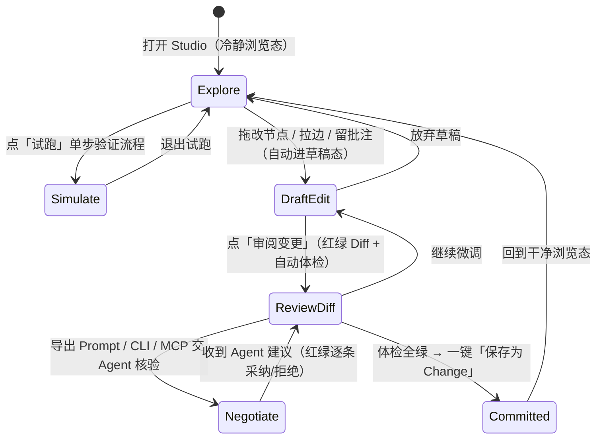

# Studio 人体工学与低认知负担交互设计调研

> 性质：UI/UX 交互语言与认知人体工学调研草案（尚未冻结为行为合约）。整理日期：2026-11-25。
> 核心设计前提：**人类注意力极其有限**——绝对不能把所有功能一股脑铺成“波音 747 驾驶舱”，必须依靠 **模式状态机约束 + 渐进披露 + 主动引导分析** 保护专注力。

---

## 一、标杆产品交互语言调研（可直接学习的 6 种模式）

| 参考项目 | 核心交互思想 | 怎么化用到 `llman-sdd studio` |
| --- | --- | --- |
| **[TextFold](https://github.com/chenxiachan/textfold)** (`chenxiachan/textfold`) | **5 级真实语义折展（`全文 › 简述 › 关键句 › 要点 › 主题`）**：不是简单的前端字段隐藏/显示，而是把长文本经语义压缩转为 5 个信息梯度，且高亮与边注跨层级持久对齐 | 明确区分两层折展：① **图元字段密度**（MVP，0-Token 程序化控制是否显示守卫/步骤）；② **长文本语义折展**（针对大量 `规则:` 正文、裸规则与 `proposal/design` 长文，接入 TextFold 5 级压缩 `全文 › 简述 › 关键句 › 要点 › 主题` 并按内容哈希缓存在 `.llman-sdd/studio/`，改哪条只重算哪条） |
| **[ThoughtDAG](https://github.com/chenxiachan/thoughtdag)** (`chenxiachan/thoughtdag`) | **“Wires are the context（连线即上下文）”**：用可视化 DAG 精准控制哪些节点进 LLM 上下文，剪线即可剔除噪声，并支持镜像本地 Agent 会话日志 | **“所选即 Prompt 上下文”**：人类在画布上勾选/框选关心的状态、边和评论，右侧透明展示「待发上下文胶囊（含预估 Token）」，拒绝一股脑把整仓塞给 Agent |
| **Heptabase** | **分层容器 + 面包屑防迷路**：卡片 ↔ 白板 ↔ 全局地图明确分容器，不在同一平面塞满不同抽象层级 | 顶层导航按能力/状态机分板，面包屑明确显示当前在哪一层（如 `项目总览 / change-lifecycle / stage`），绝不在无限画布里迷失方向 |
| **Linear & Raycast** | **默认安静（Silence by Default）+ `Cmd+K` 命令面板**：静止界面极度克制、低饱和灰阶；高阶功能不常驻工具栏，按需召唤 | 默认只展示干净画布与 1–2 个主动作；重排布局、切换验证层、搜索规则、导出格式全部收进 `Cmd+K` 面板 |
| **Stately Studio** | **严格模式隔离（Design vs Simulate）**：编辑工具与单步模拟互不打架，切态才出现对应控件 | 用**状态机约束 Studio 自身的 UI 状态**（见第二节），每一刻只呈现与当前心智任务相关的控件 |
| **Figma & 空间画布局部聚焦** | **上下文检查器 + 悬停聚光灯（Local Scoping）**：未选中元素时右侧留白或只给引导；悬停某节点时仅点亮直接邻居，其余淡出至 ~25% | 专治复杂状态图“线条织毛衣眼花宕机”；点击任何一条报错或待审 Diff，镜头平滑聚焦到对应节点/边 |

---

## 二、空间模块化导航：多 Tab 业务森林 + 上下文下钻（草图细化）

为满足“不同业务节点森林可独立在 Tab 中聚焦、交叉逻辑便于人类判断、支持多级下钻且不迷路”，确立以下空间交互骨架：

### 2.1 多 Tab 视图切片（Non-Destructive Lens Tabs）
- 顶部固定轻量 Tab 栏：`[ 默认全景 ]` `[ 自定义组合 1 ]` `[ 自定义组合 2 ]` `[ + ]`。
- **自定义组合 Tab = 业务森林切片**：人类可新建一个 Tab，只拉入关心的 1–2 个业务森林（如「订单」+「库存」），屏蔽其余模块噪声；Tab 只是视图投影（存在本地 `.llmanspec-studio/`），增删 Tab 绝不修改 `llmanspec/specs/` 真理。
- **交叉桥高亮（Cross-Forest Bridge）**：当一个自定义 Tab 包含多个业务森林时，支持一键高亮横跨森林的共享事件/状态/规则依赖边，淡化各森林内部无关细节，让人类 3 秒锁定跨业务交叉风险。

### 2.2 上下文下钻 + 外围边界接口保留（Contextual Drill-Down）
- **宏观层（森林星图）**：采用 Obsidian Graph 风格权重圆点（`d3-force` 布局），圆圈大小映射复杂度/规则数，外围小卫星点展示上下游依赖；未点击节点时右侧保持留白，点击后右侧才滑出上下文操作栏。
- **微观层（下钻进某个业务节点）**：
  - 双击 `业务 A` 后，原圆圈展开为**确定性排布（`elkjs`）的状态机/流程图**（不再物理抖动，便于严肃审查逻辑与红绿 Diff）；
  - **关键人体工学细节**：展开容器的外围依然保留与 `业务 A` 相连的**外部邻居气泡与出入箭头（Boundary Portals）**；点击外部气泡先弹轻预览卡片（显示交叉契约），再由人类决定是“拉入当前 Tab 对比”还是“跳转过去”，避免打断当前思路；
  - 顶部 Tab 栏下方紧贴**路径面包屑**（如 `全景 > 业务 A（订单处理） > 异常处理`），支持任意层级一键返回，防止无限下钻迷失。

---

## 三、用「状态机」约束 Studio 自己的 UI（彻底消灭选择困难）

把 Studio 的界面收敛为 **5 个互斥模式**——人类在任意时刻都只面对一个清晰任务、一个主按钮（Primary CTA），绝不同时弹出 5 排按钮：

| UI 状态 | 屏幕呈现什么（极简约束） | 隐藏什么（保护注意力） | 唯一明确的主引导（Next Action） |
| --- | --- | --- | --- |
| **1. `Explore`（冷静浏览）** | 干净状态图 + TextFold 式细节档位滑块 + 悬停局部聚光灯 + 轻量健康徽章（绿/红） | 隐藏所有编辑表单、Diff 面板、导出选项 | 顶部 1 句轻提示：“点击状态查看规则，双击或拖端口开始演进，或点「试跑」” |
| **2. `Simulate`（单步试跑）** | 高亮当前激活状态，只点亮**此刻合法可触发的事件按钮** + 底部简短路径面包屑 | 隐藏编辑手柄与草稿 Diff | 像玩互动故事一样点事件走一遍，直观检查有没有死路或怪逻辑 |
| **3. `DraftEdit`（交互草稿）** | 顶部浮出小巧变更胶囊（`+1 状态 ~1 守卫`）+ Undo/Redo；右侧**仅在选中某元素时**显示该元素属性与评论 | 未选中时右侧只显示简短“待处理清单”，不摊开整份原文 | 改完后右上角唯一主按钮：「审阅变更 →」 |
| **4. `ReviewDiff`（红绿体检）** | 画布切为高对比度**红删 / 绿增 / 黄改**模式，未改动节点自动降噪变淡；右侧展示 **E1–E4 自动分析诊断卡**（点一条直接飞镜定位） | 隐藏常规排版工具 | 若有红灯先引导修掉；全绿后给出清晰二选一：「交 Agent 协商」或「保存为 Change」 |
| **5. `Negotiate`（Agent 协商）** | 显示 ThoughtDAG 式**上下文胶囊**（哪些 Diff 与评论将被带走）+ 一键复制 Prompt / CLI 提示；收到 Agent 经 CLI/MCP 写回的建议时，以虚线红绿建议层叠加展示 | 不直接覆写人类草稿 | 逐条点「采纳」或「忽略」Agent 建议 → 达成一致后点「保存为 Change」 |

---

## 四、针对「人类注意力弱」的 5 条核心人体工学设计原则

1. **一次只看一片区域（Focus Spotlight）**
   - 选中或悬停某个状态时，只高亮它的入边、出边与相邻状态，其他无关元素自动淡化（opacity 0.25），瞬间清屏。
2. **主动分析引导，不让用户自己“肉眼找茬”（Guided Triage）**
   - 画布不是被动白板，而是自带“副驾驶分析条”：自动告诉你 *“发现 1 个孤岛状态 `rejected`（点击定位）”*、*“有 2 条 Agent 回复待确认（点击逐条过）”*，把“漫无目的看大图”变成“点 2 下清完待办”。
3. **颜色只服务于语义，绝不乱花（Calm Visual Hierarchy）**
   - 静止态全图保持极克制的暖灰/单色调（Linear 风格）；只有 **绿（新增）、红（删除/报错）、黄（修改/警告）、蓝（当前焦点/试跑激活）** 才允许高饱和度出现，让眼睛一秒锁定重点。
4. **键盘与鼠标肌肉记忆对齐主流工具**
   - `Space + 拖` 平移、`滚轮` 缩放、`Cmd+Z / Shift+Z` 撤销重做、`Cmd+K` 全局命令/搜索、`1–4` 快速切换语义折展档位、`Esc` 逐级退回冷静态。
5. **零状态空态也要温柔引导**
   - 当仓库目前是 `0` 张 `@transitions` 状态机表（如本仓现状）时，绝不显示空白报错画布，而是直接提供 2 张轻量引导卡片：**「载入内置样例体验（--demo）」** 和 **「向导式创建第一张状态机草稿」**。
