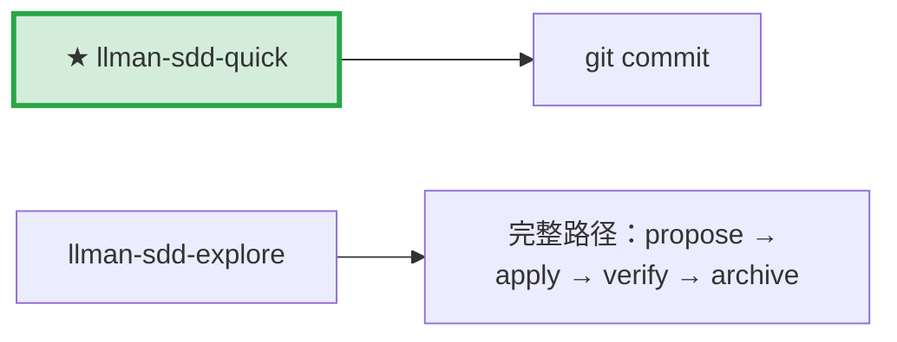

# LLMAN SDD Quick Path

不改行为合约的小改动用此路径。

## Pipeline 位置

> 📍 快速路径：直接改代码 commit。发现要改合约 → STOP，转 `llman-sdd-propose`。

## 使用条件（全部满足）
- 不改变任何 spec 中需求语义定义的外部可观测行为
- 不跨 capability；不涉及迁移/兼容性；不是 SDD 元规范变更

## 步骤
1. 用 `llman-sdd list --specs` 列出规格，再直读相关 `.feature`，确认没有要改的行为合约。
2. 直接改代码。
3. 若要动 `llmanspec/specs/**`，STOP——除非已在绑定的非默认 change 分支上（迷你 change：`change start` → 编辑 → commit）。不得在默认分支 commit specs，即使 typo 或仅收紧 scope 也不行。优先把 specs 维护路由到 `llman-sdd-propose`。
4. git commit（message 写明 why）。无需 change 目录，无需 archive。

## 边界处理
- 修改中发现要改行为合约 → STOP，转 `llman-sdd-propose`。
- 涉及多文件且 scope 不明 → 先用 `llman-sdd list --specs` 确认，再直读 `.feature`。

{{ unit("skills/cli-footer") }}

{{ unit("skills/ethics-governance") }}
