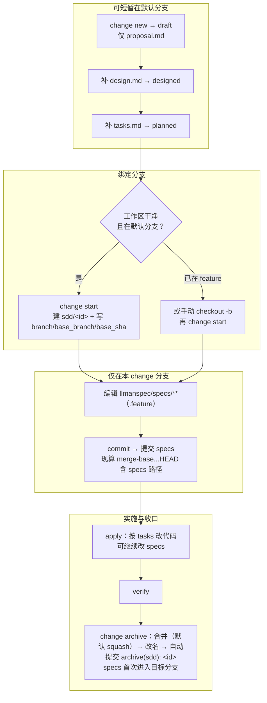

# LLMAN SDD Propose

创建带规划文档的新 change（proposal + tasks；design 可选）：**先** `change start` 绑定分支，**再**在绑定分支编辑 `llmanspec/specs/<capability>.feature` 并提交规格。

## Pipeline 位置

## Git 分支生命周期

两层别混：**分支生命周期**（绑定分支 → 提交 specs → `readyToImplement`）与 **skill 导航**（explore→propose→apply→verify→archive）。提交 specs **不是**独立 skill。

### 速览

1. **先**绑定分支（`change start`）→ `stage=full`；**再**在绑定的非默认分支编辑 `llmanspec/specs/**` 并 commit（提交 specs）。
2. 无合约编辑的 change 设 frontmatter `needs_specs_change: false`。`stage=full` 且 specs-landed 门通过（`specsLanded ∨ needs_specs_change=false`）即可进 apply；`readyToImplement=true`（gateChecks 全过，含 tasks-done）是 verify/finalize 前的完成信号。diff 范围一律现算 merge-base；存储的 `base_sha` 仅审计。
3. 收口一律 `llman-sdd change archive <id>`：先提交使工作区干净，再自动提交 `archive(sdd): <id>`（改名与合并一笔）；`--no-commit` 跳过自动提交。实施期间在 change 分支上分段提交。
4. **不得**为过干净树门禁把 specs commit 到默认分支；已绑定且未给 `--force` 不得重复 `start`。
5. worktree（可选）：`change start --worktree` 在独立 worktree 建分支、不动当前检出（`--base <branch>` 仅本地分支）记录分叉源；在非默认分支上 `change start` 按运行时信号推导分叉源、偏离默认分支时输出 WARNING；`change archive` 目标即绑定分支时跳过合并就地收口，目标被其他 worktree 持有时自动在该 worktree 内执行（输出标注位置）。

### 权威全图



上图为权威全图，本单元即其唯一来源（无需另寻根 `AGENTS.md`）。

Worktree 决策表：

| 工作形态 | 命令 | 判据 |
|---|---|---|
| 单检出 | `llman-sdd change start <id>` | 在默认分支且树干净；直接切到新分支 |
| 保留当前检出 / 并行 change | `llman-sdd change start <id> --worktree` | 分支建于独立 worktree（`sdd.worktree_root` / `sdd.worktree_naming` 可调，缺省仓库根兄弟目录），当前检出不动，输出含 worktree 路径；配 `--base <branch>`（仅本地分支）记录非默认分叉源 |
| 已在 feature 分支（含手工 wt/git-worktree） | `llman-sdd change start <id>` | 分支已存在；分叉源按 `--base` > `branch.<name>.base` / 本地 upstream 推导 > 默认分支，偏离默认分支时输出 WARNING；`--base` 仅接受本地分支 |

`change archive` 目标定位：目标即绑定分支时跳过合并就地收口（输出含 in-place close-out 提示）；目标分支被其他 worktree 持有时，`llman-sdd change archive <id>` 自动在该 worktree 内完成合并、改名与提交（输出含 `executed in target worktree <path>`）；持有 worktree 脏时中止报错并列出处置选项（零写入）。
# 人读摘要（强制）

每份报告、交接或门禁输出，必须 在任何机器细节之前先给人读摘要：

- **结论** — 一行（如“门禁全绿”/“发现 2 个 CRITICAL”）。
- **风险** — 最多三条，按影响降序。
- **待决策** — 明确提问，或“无”。

十行以内；细节放折叠线以下。

> 当前在 propose 阶段：规划文档 → 绑定分支 → 提交 specs（至 specs-landed 门通过）→ 下一步 `llman-sdd-apply`。小改动走 `llman-sdd-quick`，只记想法走 `llman-sdd-draft`。

## 硬约束

- **人类定理只读**：先查阅 `llmanspec/theorems/`，提案不得违背既有硬不变量，也不得修改定理文件。
- **change id 非阻塞**：用户给了就用；否则推导合法 kebab-case id（动词前缀），宣布后直接继续，不得等确认。
- **specs 唯一事实来源**：只在绑定后的非默认分支编辑 `llmanspec/specs/**`，不得在默认分支改 specs；不得中途问“是否继续”。

- **change 已存在**：STOP。specs-landed 门已绿 → 宜接 `llman-sdd-apply`；否则用 `llman-sdd-continue`。

- **frontmatter 固定 schema**：`proposal.md` 只填合法字段（`title` 必填一句话概念标题，`depends_on`/`blocks`/`needs_specs_change` 等），不得写 `status`/`priority`/`author` 等集外字段。

## 核心步骤

1. **预检与定界**：读 `llmanspec/config.yaml`；跑 `llman-sdd validate --all --strict` 与 `llman-sdd list --specs`，直读相关 `.feature`。非行为合约改动转 `llman-sdd-quick`。
2. **创建规划工件**：运行 `llman-sdd change new <change-id>` 充实 `proposal.md`（Why / What Changes / Capabilities / Impact），有权衡时补 `design.md`。破坏性合约变更必须规划 `migrations/v<from>-v<to>/` 升级路径。
3. **撰写 `tasks.md`**：先确认由 `.feature` GWT 驱动的公共测试边界（seam）；按垂直切片拆任务并标 `[blocked-by: <id>]`。**`tasks.md` 只列实现与验证任务**：收口（`change archive`）是流水线步骤，不得列为任务。前后对比类完成判据必须注明在 change 分支上测量（相对 merge-base）。
4. **绑定分支并提交 specs**：先运行 `llman-sdd change start <change-id>`，再在绑定分支编辑 `.feature` 并 commit（无合约编辑时设 `needs_specs_change: false`）。`stage=full` 且 specs-landed 门通过即可进 apply；`readyToImplement=true` 是 verify/finalize 的完成信号。
   - **结构化新增首选**：用 `llman-sdd spec next-req-id`、`llman-sdd spec add-req`、`llman-sdd spec add-scenario`、`llman-sdd spec new`、`llman-sdd spec resolve-req`。
   - **可执行场景优先判据**：凡 GWT（假如/当/那么）可自动判定的行为 必须 落成嵌套 `场景:`（例如：“当 运行 validate 后，那么 stdout 为 TOON 且退出码为 0”）；抽象目标或治理约束暂不可自动化时可留裸 `规则:` 并在 proposal/design 记录理由。
   - **可选 `specs:` runner**：若 `config.yaml` 缺 `specs:` 且含可执行场景，先询问用户是否启用，不得静默添加。
   - **Studio 草稿协商**：收到 Studio 草稿 ID 时，优先用 `llman-sdd studio diff`、`llman-sdd studio validate`、`llman-sdd studio comment reply` 与 `llman-sdd studio revise` 核验并回推；绑定特性分支后再 `llman-sdd studio apply`（任意分支可 `--dry-run` 预览）。
5. **校验**：运行 `llman-sdd validate <change-id>` 通过结构门（`--strict` 留到实施完成时判定）。通过后宜接 `llman-sdd-apply`。

## 单轨 Feature 合约规范

每个 capability 只有一个 Gherkin 文件：扁平 `llmanspec/specs/<capability>.feature`（默认）或目录 `llmanspec/specs/<capability>/` 内同名主文件——二选一，同 id 两布局并存算冲突。它是唯一的 spec 工件（不存在 `spec.toon`）。

- capability 即 discover 在实例内从路径分配后的 spec id，`功能:` 标题必须等于该 id；不得要求或生成 `# capability:` 头。
- 头注释 `# language:`（方言）必填：缺失则解析器回退默认方言，条款可能按错误方言解析。
- 覆盖分级：enforced（`规则:` 含嵌套 `场景:`）/ pending（裸 `规则:`）——`list --specs` 逐项输出；pending 由聚合计数与 specs-compact 承担压降。
- 缩进层级两空格递进：块 `规则:` 2 格、嵌套 `场景:` 4 格、步骤 6 格。

> 命令细节用 `llman-sdd <cmd> --help` 查看；命令参考以 CLI 为准，skill 不内嵌命令表。
> 文中“规约”= 本项目 `llmanspec/specs/` 下的 `.feature` 文件；用 `llman-sdd list --specs` / `llman-sdd show <capability>` 查全文。
校验修复（单轨 feature-as-spec）：

1）缺 `# purpose:` 头注释：每个 capability `.feature` 必须含非空 `# purpose:`；`功能:` 标题必须等于 discover 分配后的 spec id（`llman-sdd list --specs` 查看 id）。
```
# language: zh-CN
# purpose: 一句话概述

功能: <spec-id>
```

2）原生分层格式（`rule must carry an @req:<req_id> tag on the rule header`）：
- 规范样式只有一种：`@req:<id>` 挂在 `规则:` 块头标签,块内嵌套 `场景:`(假如/当/那么)是可执行示例——默认首选。
- 仅当需求无法程序化表达或暂不转写时才保留无嵌套场景的 `规则:`(裸规则):描述自由文本,不强制情态词;validate 以聚合计数提示,review `pending` 信号计量,specs-compact 负责压降。
- 历史标签 `@executable`/`@rule`/`@human`/`@manual` 不再使用、解析惰性;旧文件不再提供迁移命令,历史标签保持惰性。
- 不在任何 `规则:` 内的顶层 `场景:` 是功能级示例:无规则句柄、不告警、不参与规则统计(Gherkin 原生语义)。

分支护栏：
- 先 `change start` 绑定分支，再在绑定的非默认分支编辑 `.feature` 并 commit（提交 specs）。
- 锁定规则（报告制）：改/删既有 `规则:` 块只出 WARNING，不阻断 validate / finalize / `change diff`；报告按 `@req:<id>` 指明被改规则。控制点：git 分支对比 + `llman-sdd review` / `change diff`。旧锁定确认元数据（frontmatter `rules_touched` / `agent_acked`、`@agent` tag、`--yes` 确认语义）已全部删除，无别名无兼容层。
- `stage=full` 且 specs-landed 门通过（specsLanded ∨ `needs_specs_change: false`）即可进 apply；verify/finalize 须 `readyToImplement=true`（完成信号）。收口优先 `change archive`。

## Context
- 先查状态再动手：change/spec 状态以 `llman-sdd show/list/validate` 输出为准；读 spec 全文前先 `llman-sdd list --specs`，再直读 `.feature`。

## Goal
- 达成一个可验证结果；报告附结果路径与校验状态。

## Constraints
- 遵守正文硬约束与 `llmanspec/theorems/` 只读人类定理（不得由 Agent 擅自修改）。先判断规模选路径：合约变更走完整 SDD，实现层走 quick；不确定选完整 SDD。改动最小；已知校验错误不得强行继续。

## Workflow
- 每步以 `llman-sdd` 命令结果为事实来源；改动工件后必跑 `llman-sdd validate`；命令细节见 `llman-sdd <cmd> --help`。

## Decision Policy
- 高影响歧义先澄清再继续；事实自己查证，只有决策问用户。

## Output Contract
- 先给人读摘要（结论 / 风险 / 待决策），机器细节随后。

## Ethics Governance
- `ethics.risk_level`：low——只读写本仓库与 `llmanspec/`，无外发动作；正文另有声明时按正文执行。
- `ethics.prohibited_actions`：违反正文硬约束的动作；用户未明确要求时，不得 push、发 PR 或向外部上传。
- `ethics.required_evidence`：结论必须给出命令输出或文件路径；门禁状态以 `llman-sdd validate` 输出为准。
- `ethics.refusal_contract`：门禁 CRITICAL 未清零时，不得进入下一阶段；自修复达到上限时，报告 blocker。
- `ethics.escalation_policy`：改动 SDD 合约、模板，或执行不可逆动作前，必须先取得用户确认。
